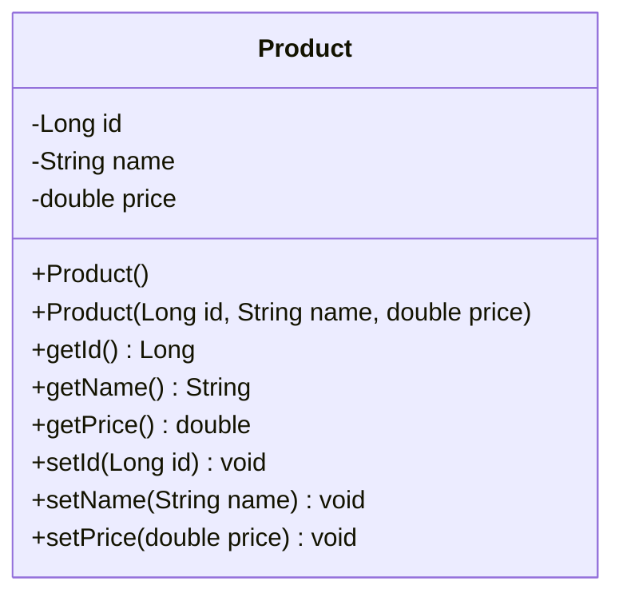
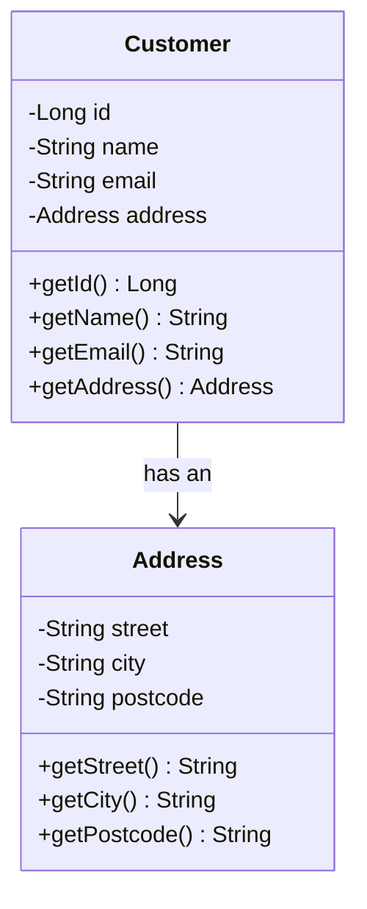
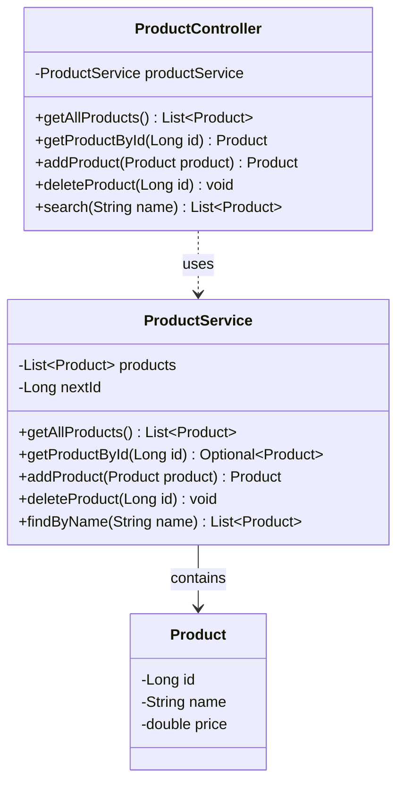
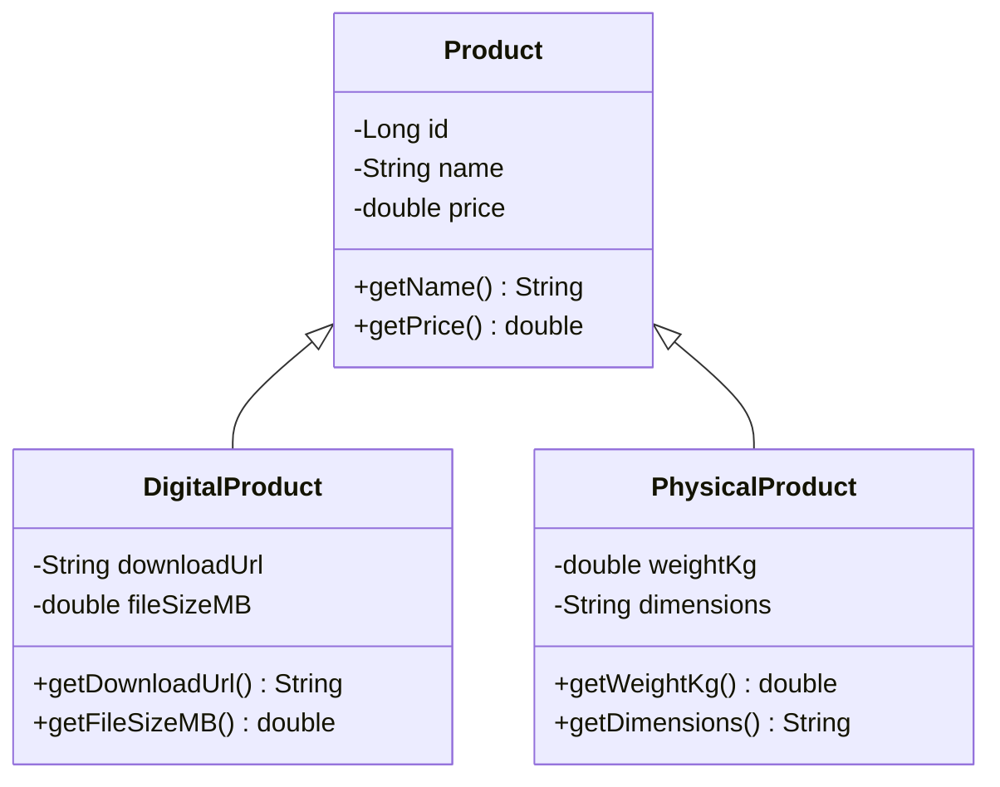

# UML Class Diagrams

The `.puml` files are PlantUML source. Render these with PlantUML (or a compatible IntelliJ plugin).
The diagrams below are also provided as Mermaid so **GitHub displays them without installing PlantUML**.

## Product Class

## Customer and Address Association

## Controller and Service Layer

## Product Inheritance Hierarchy

